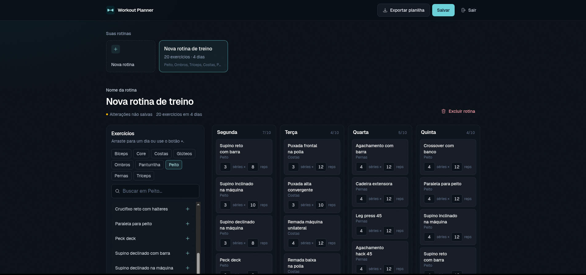
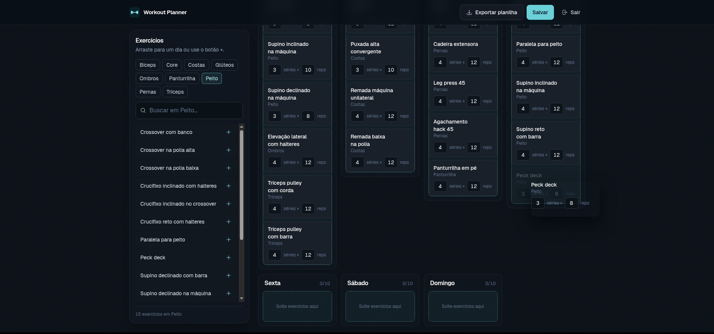

# Workout Planner

Aplicação web para montar rotinas de treino personalizadas e exportá-las em planilhas Excel. O projeto é dividido em backend com FastAPI, frontend com Angular e um seed para popular a base inicial de exercícios.


<div align="center">
  
  
  
</div>

## Funcionalidades

- Cadastro e autenticação de usuários com JWT
- Listagem e filtro de exercícios por nome e grupo muscular
- Criação, edição, consulta e remoção de rotinas de treino
- Exportação de rotinas para arquivo `.xlsx`
- Seed idempotente do catálogo de exercícios (`python -m app.seed`)

## Tecnologias Utilizadas

### Backend

- Python 3.12+
- FastAPI + Pydantic v2
- SQLAlchemy 2 + Alembic
- PostgreSQL (driver `psycopg` 3)
- `PyJWT` para tokens JWT e `pwdlib` (Argon2) para hash de senhas
- `XlsxWriter` para geração de planilhas

### Frontend

- Angular 22 (componentes standalone, signals, sem zone.js)
- TypeScript 6
- Tailwind CSS 4
- Angular CDK (drag and drop)
- RxJS

### Ferramentas de apoio

- Uvicorn
- Pytest
- Ruff (lint e formatação)
- Vitest
- Prettier
- npm

## Como Rodar o Projeto Localmente

### 1. Pré-requisitos

Antes de começar, tenha instalado na máquina:

- Python 3.12+
- Node.js 24.15+ (há um `.nvmrc` em `frontend/`; com nvm, basta `nvm use`) e npm
- PostgreSQL

Opcionalmente, você também pode usar Docker apenas para subir o banco local.

### 2. Clone o repositório

```bash
git clone <URL_DO_REPOSITORIO>
cd workout-planner
```

### 3. Suba o banco de dados PostgreSQL

O `compose.yaml` na raiz do projeto sobe um PostgreSQL 18 com volume persistente e healthcheck:

```bash
docker compose up -d db
docker compose ps        # aguarde o status "healthy"
```

O banco fica acessível apenas em `localhost:5433` (porta escolhida para não conflitar com um PostgreSQL local na 5432), com usuário `postgres`, senha `postgres` e banco `workout_planner`. Esses valores podem ser alterados pelas variáveis `POSTGRES_USER`, `POSTGRES_PASSWORD`, `POSTGRES_DB` e `POSTGRES_PORT` (por exemplo, em um arquivo `.env` na raiz).

Outros comandos úteis:

```bash
docker compose logs -f db                                    # logs do banco
docker compose exec db psql -U postgres -d workout_planner   # console SQL
docker compose down                                          # para o banco (mantém os dados)
docker compose down -v                                       # para e APAGA os dados
```

### 4. Configure e rode o backend

Entre na pasta do backend, crie o ambiente virtual e instale as dependências:

```bash
cd backend
python3 -m venv venv
source venv/bin/activate
pip install -r requirements-dev.txt   # ou requirements.txt para apenas executar
```

Crie o arquivo `backend/.env` a partir do exemplo e ajuste os valores:

```bash
cp .env.example .env
```

| Variável | Descrição |
| --- | --- |
| `DATABASE_URL` | URL do PostgreSQL (`postgresql://...` usa o driver psycopg 3 automaticamente) |
| `ENVIRONMENT` | `development`, `test` ou `production`. Em `production`, `/docs`, `/redoc` e `/openapi.json` ficam desativados |
| `JWT_SECRET_KEY` | Segredo do JWT, com no mínimo 32 caracteres e aleatório. Gere com `python -c "import secrets; print(secrets.token_urlsafe(48))"`; a API não inicia com o valor de exemplo |
| `ACCESS_TOKEN_EXPIRE_MINUTES` | Validade do token (padrão: 60) |
| `CORS_ORIGINS` | Lista JSON de origens permitidas (padrão: `["http://localhost:4200"]`) |
| `LOGIN_RATE_LIMIT_PER_MINUTE` | Tentativas de login por IP por minuto (padrão: 20) |
| `LOGIN_FAILURE_LIMIT` | Falhas de login por e-mail a cada 15 minutos antes do bloqueio temporário (padrão: 10) |
| `REGISTER_RATE_LIMIT_PER_HOUR` | Cadastros por IP por hora (padrão: 10) |
| `PASSWORD_HASH_CONCURRENCY` | Hashes de senha (Argon2, ~64 MiB cada) executados ao mesmo tempo (padrão: 4) |

Os limites de tentativas ficam em memória e valem por processo: com vários workers ou réplicas, cada um conta separadamente. Atrás de um proxy reverso, inicie o uvicorn com `--proxy-headers --forwarded-allow-ips=<ip do proxy>` para que os limites usem o IP real do cliente, e não o do proxy.

Aplique as migrações e popule o catálogo de exercícios (o seed é idempotente e pode ser executado novamente sempre que o catálogo mudar):

```bash
alembic upgrade head
python -m app.seed
```

Inicie a API:

```bash
uvicorn app.main:app --reload
```

Com a API em execução:

- Backend: `http://localhost:8000`
- Swagger UI: `http://localhost:8000/docs` (desativado com `ENVIRONMENT=production`)
- Health checks: `GET /health` (processo no ar) e `GET /health/ready` (verifica o banco)

### 5. Configure e rode o frontend

Abra um novo terminal e entre na pasta do frontend:

```bash
cd frontend
nvm use   # opcional: seleciona a versão do Node definida em .nvmrc
```

Instale as dependências:

```bash
npm install
```

Inicie a aplicação Angular:

```bash
npm start
```

O frontend ficará disponível em:

```text
http://localhost:4200
```

Por padrão, o frontend já está configurado para consumir a API em `http://localhost:8000/api/v1`.

### 6. Fluxo esperado para desenvolvimento

Com backend e frontend rodando, o fluxo local fica assim:

1. Acesse `http://localhost:4200`
2. Crie uma conta ou faça login
3. Pesquise exercícios e filtre por grupo muscular
4. Monte sua rotina de treino
5. Exporte a rotina para planilha Excel

## Comandos Úteis

### Backend

Dentro de `backend/`, com o ambiente virtual ativo:

```bash
pytest                 # testes (usam SQLite em memória, não precisam de banco)
ruff check .           # lint
ruff format .          # formatação
alembic check          # confere se os modelos estão em sincronia com as migrações
```

### Frontend

Dentro de `frontend/`:

```bash
npm test               # testes unitários (Vitest)
npm run build          # build de produção em dist/
npm run format         # formata o código com Prettier
npm run format:check   # confere a formatação (útil em CI)
```

## Observações

- O CORS do backend está configurado para permitir `http://localhost:4200`.
- A API não cria tabelas nem executa o seed ao subir: use `alembic upgrade head` e `python -m app.seed`.
- Para manter o ambiente consistente, prefira usar as migrações do Alembic antes de iniciar o desenvolvimento.
