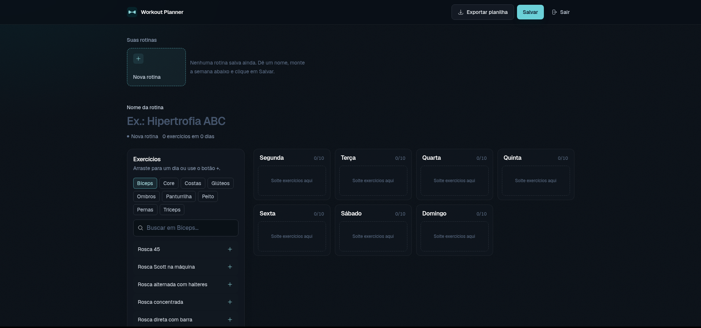

# Workout Planner

Aplicação web para montar rotinas de treino personalizadas e exportá-las em planilhas Excel. O projeto é dividido em backend com FastAPI, frontend com Angular e um seed para popular a base inicial de exercícios.


<div align="center">
  
  
  
</div>

## Funcionalidades

- Cadastro e autenticação de usuários com JWT
- Listagem e filtro de exercícios por nome e grupo muscular
- Criação, edição, consulta e remoção de rotinas de treino
- Exportação de rotinas para arquivo `.xlsx`
- Seed idempotente do catálogo de exercícios (`python -m app.seed`)

## Tecnologias Utilizadas

### Backend

- Python 3.12+
- FastAPI + Pydantic v2
- SQLAlchemy 2 + Alembic
- PostgreSQL (driver `psycopg` 3)
- `PyJWT` para tokens JWT e `pwdlib` (Argon2) para hash de senhas
- `XlsxWriter` para geração de planilhas

### Frontend

- Angular 14
- TypeScript
- Tailwind CSS
- RxJS
- Angular Router

### Ferramentas de apoio

- Uvicorn
- Pytest
- Ruff (lint e formatação)
- Karma / Jasmine
- npm

## Como Rodar o Projeto Localmente

### 1. Pré-requisitos

Antes de começar, tenha instalado na máquina:

- Python 3.12+
- Node.js e npm
- PostgreSQL

Opcionalmente, você também pode usar Docker apenas para subir o banco local.

### 2. Clone o repositório

```bash
git clone <URL_DO_REPOSITORIO>
cd workout-planner
```

### 3. Suba o banco de dados PostgreSQL

Se você já possui um PostgreSQL local, basta criar um banco chamado `workout_planner`.

Exemplo usando Docker:

```bash
docker run --name workout-planner-db \
  -e POSTGRES_USER=postgres \
  -e POSTGRES_PASSWORD=postgres \
  -e POSTGRES_DB=workout_planner \
  -p 5432:5432 \
  -d postgres:16
```

### 4. Configure e rode o backend

Entre na pasta do backend, crie o ambiente virtual e instale as dependências:

```bash
cd backend
python3 -m venv venv
source venv/bin/activate
pip install -r requirements-dev.txt   # ou requirements.txt para apenas executar
```

Crie o arquivo `backend/.env` a partir do exemplo e ajuste os valores:

```bash
cp .env.example .env
```

| Variável | Descrição |
| --- | --- |
| `DATABASE_URL` | URL do PostgreSQL (`postgresql://...` usa o driver psycopg 3 automaticamente) |
| `JWT_SECRET_KEY` | Segredo do JWT, com no mínimo 32 caracteres |
| `ACCESS_TOKEN_EXPIRE_MINUTES` | Validade do token (padrão: 60) |
| `CORS_ORIGINS` | Lista JSON de origens permitidas (padrão: `["http://localhost:4200"]`) |

Aplique as migrações e popule o catálogo de exercícios (o seed é idempotente e pode ser executado novamente sempre que o catálogo mudar):

```bash
alembic upgrade head
python -m app.seed
```

Inicie a API:

```bash
uvicorn app.main:app --reload
```

Com a API em execução:

- Backend: `http://localhost:8000`
- Swagger UI: `http://localhost:8000/docs`
- Health checks: `GET /health` (processo no ar) e `GET /health/ready` (verifica o banco)

### 5. Configure e rode o frontend

Abra um novo terminal e entre na pasta do frontend:

```bash
cd frontend
```

Instale as dependências:

```bash
npm install
```

Inicie a aplicação Angular:

```bash
npm start
```

O frontend ficará disponível em:

```text
http://localhost:4200
```

Por padrão, o frontend já está configurado para consumir a API em `http://localhost:8000/api/v1`.

### 6. Fluxo esperado para desenvolvimento

Com backend e frontend rodando, o fluxo local fica assim:

1. Acesse `http://localhost:4200`
2. Crie uma conta ou faça login
3. Pesquise exercícios e filtre por grupo muscular
4. Monte sua rotina de treino
5. Exporte a rotina para planilha Excel

## Comandos Úteis

### Backend

Dentro de `backend/`, com o ambiente virtual ativo:

```bash
pytest                 # testes (usam SQLite em memória, não precisam de banco)
ruff check .           # lint
ruff format .          # formatação
alembic check          # confere se os modelos estão em sincronia com as migrações
```

### Frontend

Gerar build de produção:

```bash
npm run build
```

## Observações

- O CORS do backend está configurado para permitir `http://localhost:4200`.
- A API não cria tabelas nem executa o seed ao subir: use `alembic upgrade head` e `python -m app.seed`.
- Para manter o ambiente consistente, prefira usar as migrações do Alembic antes de iniciar o desenvolvimento.
